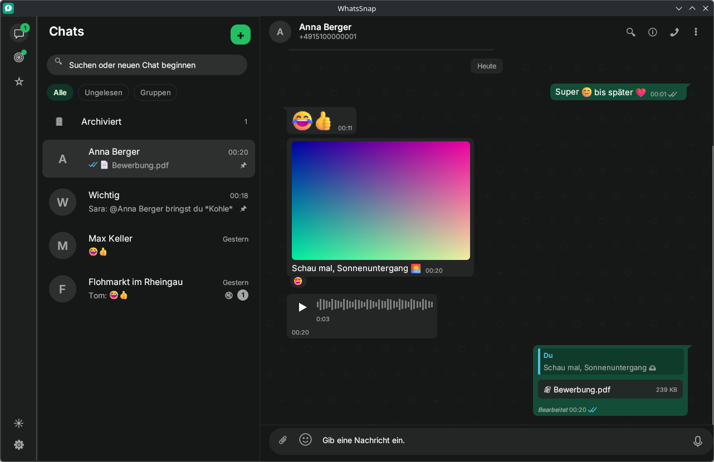

<p align="center">
  
</p>

<h1 align="center">WhatsSnap</h1>

<p align="center">
  <b>Schneller, nativer WhatsApp-Client für Linux – in Rust, ohne Browser und ohne Electron.</b>
</p>

<p align="center">
  <a href="https://github.com/Xinzoooo/wa-snap/releases/latest"></a>
  
  
  <a href="LICENSE"></a>
</p>

<p align="center">
  
</p>

> ⚠️ **Inoffizielles Projekt.** WhatsApp bietet für private Konten keine offizielle API. Inoffizielle Clients können gegen die Nutzungsbedingungen von Meta verstoßen und zur Sperrung des Kontos führen. Benutzung auf eigene Gefahr, am besten zuerst mit einer Zweitnummer. Dieses Projekt steht in keiner Verbindung zu WhatsApp oder Meta.

## Warum WhatsSnap?

- **Nativ statt Web-Wrapper** – Oberfläche mit [egui](https://github.com/emilk/egui), Protokoll über [`whatsapp-rust`](https://github.com/jlucaso1/whatsapp-rust). Startet schnell, braucht wenig Speicher.
- **Fühlt sich an wie WhatsApp Web** – Chatliste, Sprechblasen, Haken, 3D-Emojis, hell und dunkel.
- **Alles Wichtige drin** – Fotos, Videos, Sprachnachrichten, Sprachanrufe, Status, Kanäle, Gruppen, Umfragen.
- **Deine Daten bleiben bei dir** – lokaler Verlauf, Dateirechte nur für dich, Log ohne Telefonnummern.

## Highlights

| | |
|---|---|
| 💬 **Chatten** | Antworten, Reaktionen, Bearbeiten, Weiterleiten, @Erwähnungen, Formatierung, Entwürfe, Suche über alle Chats |
| 📷 **Medien** | Fotos, Videos, GIFs und Sticker mit eingebautem Betrachter; Bilder per Strg+V; eigene Sticker; GIF-Suche |
| 🎙️ **Sprache** | Sprachnachrichten aufnehmen und abspielen, Sprachanrufe über PipeWire |
| 📣 **Status & Kanäle** | Status ansehen und posten, Kanäle abonnieren, lesen, reagieren, selbst posten |
| 🔔 **Desktop** | Benachrichtigungen, Tray-Symbol mit Ungelesen-Punkt, Autostart in die Leiste, Tastenkürzel |
| 🔒 **Sicher** | Gefährliche Dateitypen nur nach Warnung, ffmpeg nur für lokale echte Container, Instanz-Sperre |
| ✨ **Extras** | Gelöschte Nachrichten behalten (optional), frühere Fassungen bearbeiteter Nachrichten, mehr als 3 angeheftete Chats |

<details>
<summary><b>Alle Funktionen (v0.15.1)</b></summary>

- Aussehen wie WhatsApp Web: Seitenleiste, Chatliste mit Filtern (Alle, Ungelesen, Gruppen), „Archiviert“ oben, Sprechblasen mit Zipfel, Haken, Schrift Inter; hell und dunkel
- 3D-Emojis im Stil von WhatsApp (Microsoft Fluent Emoji, fehlende aus Twemoji) in Nachrichten, Chatliste und Auswahl; alle 1900+ Emojis mit Kategorien wie bei WhatsApp, „Letzte“, deutscher Suche und Hauttönen (Rechtsklick); reine Emoji-Nachrichten werden groß angezeigt
- Haken wie bei WhatsApp: gesendet, zugestellt, gelesen (blau)
- Beim Öffnen eines Chats werden Lesebestätigungen gesendet, der Ungelesen-Zähler am Handy geht mit
- Stumm, Anheften und Archiv über Rechtsklick auf einen Chat oder das Menü im Chat-Kopf, abgeglichen mit WhatsApp (Nummer und LID werden beide zugeordnet)
- Benachrichtigungen kommen auch, wenn das Fenster minimiert ist; Test-Knopf in den Einstellungen
- Suche in der Chatliste und im geöffneten Chat
- Symbol in der Leiste (Tray): Fenster schließen lässt WhatsSnap weiterlaufen, roter Punkt bei Ungelesenem, Rechtsklick → Beenden (abschaltbar in den Einstellungen); ein zweiter Start öffnet nur das vorhandene Fenster; Autostart startet unsichtbar in der Leiste
- Formatierung wie bei WhatsApp: `*fett*`, `_kursiv_`, `~durchgestrichen~`, `` `Code` ``
- Bilder mit Strg+V aus der Zwischenablage senden (mit Vorschau)
- Entwürfe bleiben pro Chat erhalten, „Entwurf:“ in der Chatliste
- „schreibt …“, „nimmt Sprachnachricht auf …“, „online“ und „zuletzt online“; du erscheinst online, solange das Fenster aktiv ist
- Knopf „Nach unten“ mit Zähler neuer Nachrichten; Klick auf ein Zitat springt zur Originalnachricht
- Weiterleiten (auch Fotos, Sticker, Dokumente ohne neuen Upload)
- Stummschalten für 8 Stunden, 1 Woche oder immer
- Sprachanrufe: anrufen (📞 im Chat-Kopf), annehmen und ablehnen mit Anzeige oben, stummschalten, auflegen; Ton mit 16 kHz über PipeWire (`pw-record`/`pw-play`), ersatzweise PulseAudio oder ALSA. Videoanrufe werden als Sprachanruf angenommen. Zur Fehlersuche: mit `WA_SNAP_CALL_DUMP=1 wa-snap` landen beide Richtungen als WAV in `/tmp`
- Status: Status der letzten 24 Stunden ansehen (◎ in der linken Leiste, grüner Ring = neu, Pfeiltasten blättern), eigenen Text- oder Foto-Status posten, aus dem Status in den Chat antworten
- Kanäle (im Bereich „Aktuelles“): dieselben Abos wie am Handy, Beiträge lesen und mit Emojis reagieren, Kanäle suchen oder per Link abonnieren, deabonnieren, eigenen Kanal erstellen und darin posten
- Oberfläche auf Deutsch oder Englisch (Einstellungen → Chats; Standard ist die Systemsprache)
- Chat exportieren als Textdatei in den Downloads-Ordner (⋮-Menü im Chat)
- Sicherheit: empfangene Videos und Töne werden mit ffmpeg nur als lokale Datei und nur als echter Container geöffnet (keine Playlists, keine Netzwerkadressen); Programme, Skripte und HTML öffnen nur nach Warnung
- Diagnose: Bei einer Abmeldung durch WhatsApp steht der Grund im Log (`~/.local/share/wa-snap/wa-snap.log`), ebenso Warnungen der WhatsApp-Bibliothek
- Zusatzfunktionen: von anderen gelöschte Nachrichten weiter anzeigen (Schalter unter Einstellungen → WhatsSnap, standardmäßig aus), frühere Fassungen bearbeiteter Nachrichten ansehen (Maus über „Bearbeitet ⓘ“), mehr als 3 Chats anheften (ab dem 4. nur in WhatsSnap)
- Eigene Nachrichten bearbeiten (bis 15 Minuten), „Bearbeitet“-Hinweis
- @Erwähnungen in Gruppen mit Vorschlagsliste; Erwähnungen werden mit Namen hervorgehoben
- Nachrichten mit Stern markieren (abgeglichen mit WhatsApp), Übersicht über ☆ in der linken Leiste
- Umfragen anzeigen und abstimmen, Standort (Öffnen in OpenStreetMap), Kontaktkarten mit „Chat starten“, Link-Vorschau
- Einmal-Ansicht und selbstlöschende Nachrichten werden gekennzeichnet; in Chats mit Selbstlöschen gilt das auch für eigene Nachrichten
- Suche über alle Chats: passende Nachrichten erscheinen unter der Suche, Klick springt hin
- Ältere Nachrichten: Knopf oben im Chat zeigt mehr an bzw. lädt weitere vom Handy; beim Verknüpfen werden bis zu 300 Nachrichten pro Chat übernommen
- Tastenkürzel: Strg+F Suche, Strg+N neuer Chat, Esc schließt, Alt+↑/↓ wechselt den Chat
- Verknüpfung per QR-Code, die Sitzung bleibt gespeichert; beim Verknüpfen wird der Verlauf der letzten 365 Tage angefordert
- Verlauf wird lokal gespeichert und ist nach dem Neustart wieder da
- Namen aus dem Adressbuch, Gruppennamen direkt vom Server, Profilbilder mit Zwischenspeicher
- Mehrzeilig schreiben (Shift+Enter), senden mit Enter
- Einstellungen aufgebaut wie bei WhatsApp: Profil (Name, Info, Profilbild), Konto (Abmelden, lokale Daten löschen), Datenschutz (zuletzt online, online, Profilbild, Info, Gruppen, Anrufe von Unbekannten, Lesebestätigungen, Standard für selbstlöschende Nachrichten, Blockierte), Chats (Design, Schrift, Enter sendet), Benachrichtigungen (Gruppen, Ton), Speicher (automatischer Download, Medien löschen), WhatsSnap (Tray, Autostart, Online-Status, „schreibt …“, GIF-Schlüssel, Tastenkürzel), Hilfe
- Kontakt- und Gruppeninfo (Klick auf den Chat-Kopf): Medien, Beschreibung, Mitglieder, gemeinsame Gruppen, Blockieren
- Gruppen: neue Gruppe anlegen (+ → Neue Gruppe), umbenennen, Mitglieder hinzufügen/entfernen, Admins ernennen, Einladungslink, verlassen; selbstlöschende Nachrichten je Chat (⋮-Menü)
- Neuer Chat per Telefonnummer (Nummer in die Suche tippen)
- Fotos und Sticker werden im Chat angezeigt, animierte Sticker bewegen sich
- Bilder und Videos direkt in der App ansehen: Klick öffnet den Betrachter über dem ganzen Fenster. Bilder: Zoom mit Mausrad oder Strg +/−, Verschieben mit der Maus, Doppelklick, `0` setzt zurück. Videos und GIFs: Abspielen/Pause (Leertaste), Spulen, Lautstärke, `,`/`.` springt 5 Sekunden. Pfeiltasten blättern durch die Medien des Chats, `F` Vollbild, Esc schließt; „Speichern unter …“ und „Extern öffnen“. Videos brauchen `ffmpeg`
- Dokumente öffnen im Standardprogramm – aber nur harmlose Typen (Bilder, Video, Audio, PDF, Office, Text) ohne Rückfrage. Bei allem anderen (`.sh`, `.jar`, `.html`, `.desktop`, `.rpm` …) und wenn der Inhalt nicht zum Namen passt, fragt WhatsSnap nach und bietet „Im Ordner anzeigen“ an
- Nicht gesendete Fotos, Videos, Dateien und Sprachnachrichten bleiben nach einem Neustart im Chat stehen: „Erneut senden“ oder „Verwerfen“ per Rechtsklick
- Fehlende Medien: „Verlauf vom Handy nachladen“ im ⋮-Menü holt die letzten rund 300 Nachrichten eines Chats erneut (Handy muss online sein); abgelaufene Bilder werden beim Absender-Gerät neu angefordert
- Sprachnachrichten direkt in der App abspielen (Wellenform, Pause, Klick zum Spulen) und aufnehmen (Mikrofon-Knopf, wenn das Eingabefeld leer ist); Opus ist eingebaut, abgespielt und aufgenommen wird über PipeWire (`pw-play`/`pw-record`), ersatzweise PulseAudio oder ALSA
- Videos senden; GIF-Dateien werden mit ffmpeg (falls installiert) zu WhatsApp-GIFs umgewandelt, sonst als Dokument gesendet
- GIF-Suche über Giphy (eigener kostenloser API-Schlüssel nötig, Eintrag in den Einstellungen oder direkt im GIF-Reiter)
- Eigene Sticker aus beliebigen Bildern (📎 → Sticker aus Bild, oder im Sticker-Reiter)
- Fotos und Dateien senden: 📎 oder Datei ins Fenster ziehen; Text im Eingabefeld wird zur Bildunterschrift
- Sticker: empfangene Sticker erscheinen in der Emoji-Auswahl unter „Sticker“ und lassen sich weiterschicken
- Rechtsklick auf eine Nachricht: Reagieren, Antworten, Text kopieren, für alle löschen; Reaktionen, Antworten (Zitate), gelöschte und bearbeitete Nachrichten von anderen werden angezeigt
- Diagnose-Log: `~/.local/share/wa-snap/wa-snap.log` (höchstens rund 500 KB, eine ältere Generation als `.log.old`). Telefonnummern stehen dort nur als Kürzel. Eine Zeile pro Nachricht gibt es nur mit dem Schalter „Ausführliches Log“ unter Einstellungen → WhatsSnap

**Noch nicht vorhanden:** Videoanrufe, Fotos in Kanäle posten, verschlüsselte Sitzungsdatenbank. Fehler bitte als Issue melden.

</details>

## Installation auf Fedora (empfohlen)

Ein Befehl, danach findest du WhatsSnap in der Anwendungssuche und kannst es an die Taskleiste anheften:

```bash
sudo dnf install https://github.com/Xinzoooo/wa-snap/releases/download/v0.15.1/wa-snap-0.15.1-1.x86_64.rpm
```

Deinstallieren: `sudo dnf remove wa-snap`. Deine Anmeldedaten bleiben in `~/.local/share/wa-snap/` und werden dabei nicht gelöscht. Alle Versionen: [Releases](https://github.com/Xinzoooo/wa-snap/releases) · Änderungen: [CHANGELOG.md](CHANGELOG.md)

## Aus dem Quellcode bauen

Du brauchst [Rust](https://rustup.rs) (stabile Version), einen C-Compiler und cmake (unter Fedora: `sudo dnf install gcc cmake`, unter Debian/Ubuntu: `sudo apt install build-essential cmake`). Zur Laufzeit zusätzlich `ffmpeg` für Videos (das RPM zieht es von selbst nach).

**Variante 1: mit einem Befehl installieren**

```bash
cargo install --git https://github.com/Xinzoooo/wa-snap
wa-snap
```

**Variante 2: herunterladen und starten**

```bash
git clone https://github.com/Xinzoooo/wa-snap.git
cd wa-snap
cargo run --release
```

Der erste Build dauert einige Minuten, danach startet das Programm sofort. Beim ersten Start erscheint ein QR-Code. Scanne ihn am Handy unter **WhatsApp → Verknüpfte Geräte → Gerät hinzufügen**.

## Im Anwendungsmenü und in der Taskleiste (Linux)

```bash
wa-snap --install-desktop
```

Das legt einen Startmenü-Eintrag mit Icon an. Danach findest du WhatsSnap im Anwendungsmenü und kannst es per Rechtsklick an die Taskleiste anheften.

## Daten

Die Sitzung liegt in `~/.local/share/wa-snap/whatsapp.db` (Linux), heruntergeladene Medien in `~/.local/share/wa-snap/media/`. Alle Dateien werden nur für dich lesbar angelegt (0600, Ordner 0700). Die Datenbank enthält deine Schlüssel und ist nicht verschlüsselt: nicht weitergeben und nie in ein Repo hochladen. Abmelden geht unter Einstellungen → Konto; die Schlüssel werden danach beim nächsten Start entfernt, und WhatsSnap fragt, ob auch Verlauf und Medien gelöscht werden sollen.

## Lizenz

MIT, siehe [LICENSE](LICENSE).

Eingebaut sind außerdem libopus (BSD) und libwebp (BSD). Mitgeliefert werden die Schrift [Inter](https://github.com/rsms/inter) (SIL Open Font License 1.1, [assets/fonts/OFL.txt](assets/fonts/OFL.txt)) die Emoji-Grafiken von [Fluent Emoji](https://github.com/microsoft/fluentui-emoji) (© Microsoft, MIT, [assets/FLUENT-EMOJI-LICENSE.txt](assets/FLUENT-EMOJI-LICENSE.txt)) und [Twemoji](https://github.com/jdecked/twemoji) (© Twitter, Inc. und weitere, CC-BY 4.0, [assets/TWEMOJI-LICENSE.txt](assets/TWEMOJI-LICENSE.txt)). Reihenfolge, Kategorien und deutsche Suchbegriffe stammen aus [Emojibase](https://github.com/milesj/emojibase) (MIT). `tools/pack_emoji.py` erzeugt daraus `assets/emoji.bin` und `assets/emoji_list.json`.

---

## English

WhatsSnap is a fast, native WhatsApp client for Linux written in Rust (egui). It is unofficial and not affiliated with WhatsApp or Meta; using unofficial clients may get your account banned. The UI follows your system language (German or English) and can be switched under Settings → Chats.

Install on Fedora 40+:

```bash
sudo dnf install https://github.com/Xinzoooo/wa-snap/releases/download/v0.15.1/wa-snap-0.15.1-1.x86_64.rpm
```

Then start “WhatsSnap” from the app menu and scan the QR code with WhatsApp → Settings → Linked devices.
